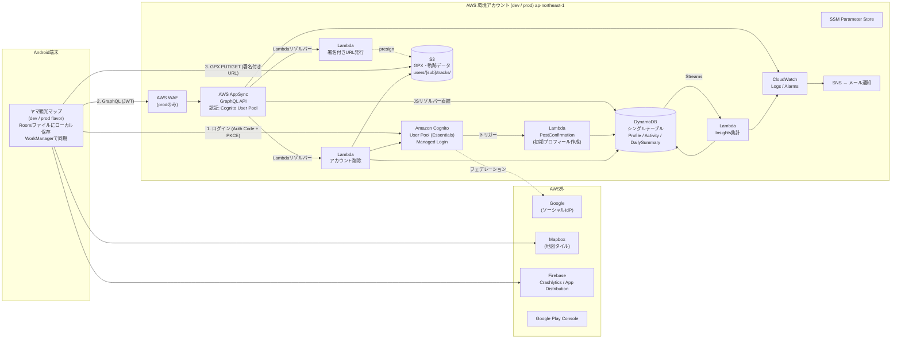
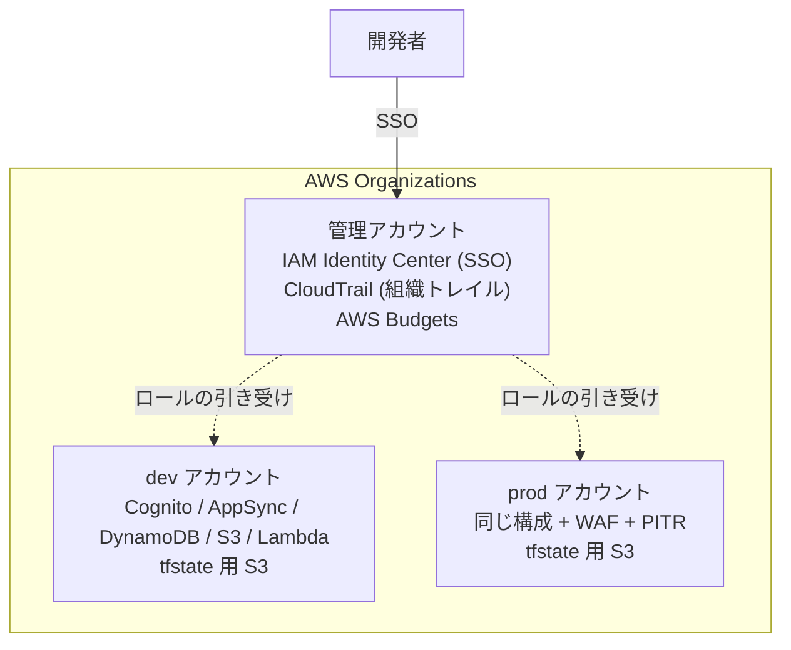
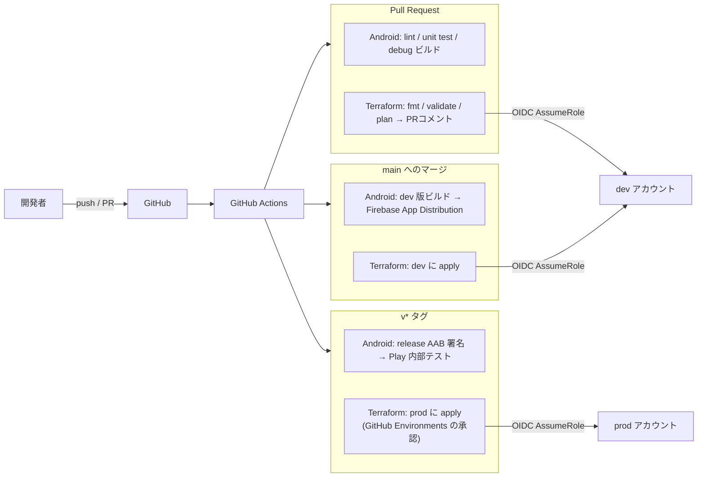
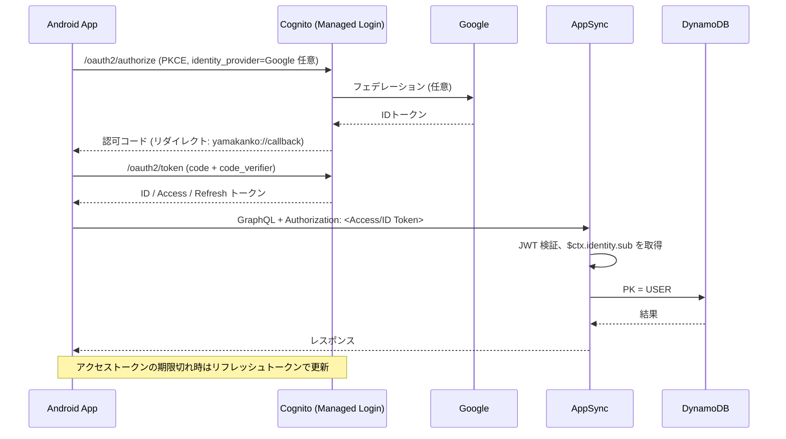

# AWS構成設計（Cognito + AppSync）

- ステータス：ドラフト
- 更新日：2026-11-19
- 前提：小中規模（〜数千MAU）、サーバーレス、無料枠／低コスト重視、オフラインファースト
- 関連ADR：[0001 認証 Cognito](../decisions/0001-auth-cognito.md) / [0002 API AppSync](../decisions/0002-api-appsync.md) / [0003 アカウント分離](../decisions/0003-aws-account-separation.md) / [0004 CI/CD](../decisions/0004-cicd-github-actions.md)

## 1. 全体構成



### 処理の流れ
1. **ログイン**：アプリは AppAuth で Cognito Managed Login を開く（Authorization Code + PKCE）。Google ログインは Cognito 経由でフェデレーションする。
2. **データ同期**：活動のメタデータとプロフィールは AppSync の Mutation/Query で DynamoDB に直接読み書きする（Lambda を挟まない）。
3. **GPX**：`getTrackUploadUrl` Mutation で署名付きURLを受け取り、端末から S3 に直接 PUT する（GraphQL に大きなデータを流さない）。
4. **集計**：Activity が書き込まれると DynamoDB Streams 経由で Lambda が日別サマリー（DailySummary）を更新し、Insights／カレンダー画面はそれを Query するだけにする。
5. **アカウント削除**（Play ポリシー対応）：`deleteAccount` Mutation → Lambda が DynamoDB・S3・Cognito のユーザーを削除する。

## 2. アカウント・環境構成



| 項目 | dev | prod |
|------|-----|------|
| Cognito User Pool | `yama-dev` | `yama-prod` |
| Android applicationId | `...yama_kanko_map_android.dev` | `...yama_kanko_map_android` |
| DynamoDB PITR | なし | あり |
| S3 バージョニング | なし | あり |
| WAF | なし | あり（レート制限） |
| ログ保持期間 | 7日 | 30日 |
| 削除保護 | なし | あり（Cognito / DynamoDB） |

stg が必要になったら、同じ Terraform モジュールで 3 つ目のアカウントを追加する。

## 3. CI/CD



- AWS への認証は **GitHub OIDC**。アクセスキーは発行しない。ロールの信頼ポリシーで `repo:atsw0q0/<repo>:ref:refs/heads/main` / `environment:prod` などに絞る。
- AppSync のスキーマ・リゾルバー・Lambda も Terraform で管理する（`terraform/` の共通モジュール + `envs/dev`, `envs/prod`）。
- Android 署名：Play App Signing を使い、アップロード鍵は GitHub Secrets（Base64）に置く。
- Android の環境ごとの設定（AppSync エンドポイント、User Pool ID、Client ID）は、`terraform output` から CI で生成して BuildConfig に注入する。

## 4. 認証シーケンス



- リゾルバーでは必ず `ctx.identity.sub` をパーティションキーに使い、他ユーザーのデータにアクセスできないようにする（クライアントから userId を受け取らない）。
- トークンは Android Keystore で保護して保存する（DataStore + Tink 等）。

## 5. データ設計（案）

### DynamoDB シングルテーブル `yama-{env}`

| PK | SK | 主な属性 |
|----|----|----------|
| `USER#{sub}` | `PROFILE` | heightCm, weightKg, targetWeightKg, updatedAt |
| `USER#{sub}` | `ACT#{startTimeISO}#{activityId}` | sportType, distanceM, durationSec, kcal, elevationGainM, trackS3Key, updatedAt, deleted |
| `USER#{sub}` | `DAY#{yyyy-MM-dd}` | totalDistanceM, totalDurationSec, totalKcal, activityCount |

- 一覧は `begins_with(SK, "ACT#")`、カレンダーは `SK between DAY#2026-11-01 and DAY#2026-11-30` で取得する。
- 同期の競合は `updatedAt` による last-write-wins + 論理削除（`deleted`）で解決する。
- 体重・位置情報はセンシティブなので、DynamoDB / S3 は KMS で暗号化する（コストを抑えるなら AWS 管理キーで可）。

### S3 `yama-tracks-{env}-{accountId}`
- キー：`users/{sub}/tracks/{activityId}.gpx`
- パブリックアクセスはブロック。署名付きURLの有効期限は5分で、Lambda は `sub` 配下のキーにしか発行しない。
- prod はライフサイクルで 90 日後に Standard-IA へ移行する。

### GraphQL スキーマ（抜粋）

```graphql
type Profile { heightCm: Float!, weightKg: Float!, targetWeightKg: Float!, updatedAt: AWSDateTime! }
type Activity { id: ID!, startTime: AWSDateTime!, sportType: SportType!, distanceM: Float!,
                durationSec: Int!, kcal: Int!, trackS3Key: String, updatedAt: AWSDateTime!, deleted: Boolean }
type DailySummary { date: AWSDate!, totalDistanceM: Float!, totalDurationSec: Int!, totalKcal: Int!, activityCount: Int! }
type UploadUrl { url: AWSURL!, key: String!, expiresAt: AWSDateTime! }
enum SportType { WALKING RUNNING TRAIL_RUNNING }

type Query {
  getProfile: Profile
  listActivities(from: AWSDateTime, to: AWSDateTime, nextToken: String): ActivityConnection!
  listDailySummaries(from: AWSDate!, to: AWSDate!): [DailySummary!]!
  getTrackDownloadUrl(activityId: ID!): UploadUrl!
}
type Mutation {
  putProfile(input: ProfileInput!): Profile!
  upsertActivity(input: ActivityInput!): Activity!
  deleteActivity(id: ID!): Activity!
  getTrackUploadUrl(activityId: ID!): UploadUrl!
  deleteAccount: Boolean!
}
```

## 6. 利用サービス一覧

| サービス | 用途 | 環境 |
|----------|------|------|
| AWS Organizations / IAM Identity Center | アカウント分離・SSO | 管理 |
| CloudTrail / AWS Budgets | 監査・コストアラート | 管理 |
| Amazon Cognito (Essentials) | 認証・Google フェデレーション | dev / prod |
| AWS AppSync | GraphQL API | dev / prod |
| Amazon DynamoDB (オンデマンド) + Streams | データ保存・集計トリガー | dev / prod |
| AWS Lambda | 署名付きURL・集計・アカウント削除・Cognito トリガー | dev / prod |
| Amazon S3 | GPX 保存・Terraform state | dev / prod |
| AWS KMS | 暗号化 | dev / prod |
| SSM Parameter Store | 設定値 | dev / prod |
| CloudWatch / SNS | 監視・通知 | dev / prod |
| AWS WAF | レート制限 | prod |
| IAM OIDC Provider | GitHub Actions 連携 | dev / prod |

## 7. 未決事項
- [ ] Google ログインを初期リリースに含めるか
- [ ] ゲスト利用（未ログインでのローカル利用）を許可するか
- [ ] stg 環境の要否
- [ ] KMS をカスタマー管理キーにするか（月額費用が増える）
- [ ] アラートの通知先（メール / Slack）
- [x] ADR を作成する（0001〜0004）
